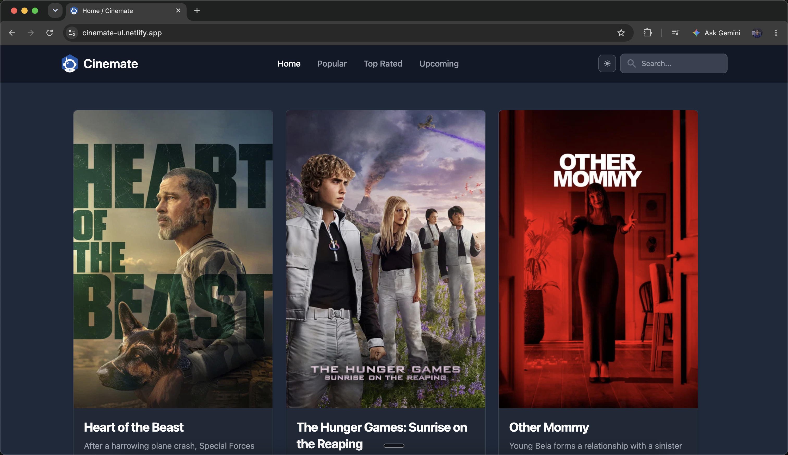

# Cinemate

Cinemate is a movie discovery app. Browse now-playing, popular, top-rated, and upcoming movies, search by title, or open a movie to see its ratings and details. The app has light and dark themes and uses movie data from The Movie Database (TMDB).

[Try the live demo](https://cinemate-ul.netlify.app/)



## Run locally

Use Node.js **26.13.1**. Cinemate uses React and React DOM **19.3.1**, React Router DOM **6.4.0**, and Tailwind CSS **3.4.19**.

Movie lists and search use a TMDB API key. Follow the [TMDB API setup guide](https://developer.themoviedb.org/docs/getting-started) to get a key, then create a `.env.local` file in the project folder:

```dotenv
REACT_APP_API_KEY=your_tmdb_api_key
```

From the project folder, run the following commands:

```sh
npm ci
npm start
```

Open [localhost:3000](http://localhost:3000). Run `npm run build` to create a production build in `build/`.
